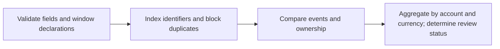

# CutoverGuard: 3.5-minute demo and submission draft

This is an earlier pitch draft. The
retail file-ingestion extension and dashboard dollar update
were implemented locally but require new user Terminal execution before live claims.

## Rehearsed pitch

**0:00–0:20 — Hook.** “Both ledgers total $3,000. But the money belongs to the wrong
accounts. CutoverGuard checks whether a migration candidate preserves financial
ownership, transaction by transaction.” Show the defective overview immediately.

**0:20–1:10 — Live evidence.** Open Findings: E1 moved from 0001 to 0002; E2 moved
from 0002 to 0001. Open Account impact: +$1,000 / −$1,000, firm net zero. Explain
$2,000 is a double-sided allocation discrepancy, not money lost. This is synthetic
example data. Optional two-event replay shows the first divergence; call it a
controlled parallel-run illustration, not a production digital twin.

**1:10–1:40 — Corrected candidate and review.** Select fixed: zero findings, ready
for human review. Show JSON/CSV export and the run fingerprint. “Critical breaks
block; missing evidence stays incomplete. Passing checks does not approve cutover.”

**1:40–2:25 — Databricks contribution.** Show the actual persisted Delta results
and native dashboard. “SQL computes findings and account effects on Databricks;
we verify every returned result against an exact local reference.” Show statement
IDs if asked. Show pre-verified Genie response with its signed chart: “The LLM
explains verified tables. We inspect its generated SQL and calculations.” Use live
Genie only as an optional follow-up, never as the sole working demonstration.

If file ingestion has actually succeeded, add: “The historical retail extract
arrived as files in a Volume, was prepared in Delta and checked against the full
oracle.” Disclose GBP invoice lines and controlled defects. If unexecuted, omit
this claim and describe it only as prepared next work.

**2:55–3:30 — Why this workflow / limits.** Existing ETL and migration comparison
tools remain relevant; the contribution here is a finance review workflow around
row-level ownership, account effects and reproducible evidence. The local engine
is a bounded exact reference. No production connectors, automatic remediation or
regulatory certification. Close with the observed result: matching firm totals
cannot establish correct account ownership. Leave the remaining judging time for questions.

## Four-box technical explanation

Integer minor units avoid float money errors. Duplicates block ambiguous joins
rather than choosing an arbitrary row. Currencies never combine. Fingerprints bind
inputs and rule versions to evidence. Completion and dependencies are declared.

## Devpost draft

**Name:** CutoverGuard — same total, different owner

**Inspiration:** Legacy-to-cloud financial migrations need more than matching row
counts and firm totals. Opposite account allocation errors can cancel.

**What it does:** Compares account profiles and transactions across supplied
snapshots, identifies exact differences, calculates account/currency effects and
exports evidence for blocked, incomplete or ready-for-human-review outcomes.

**How we built it:** Python 3.12, exact integer amounts, deterministic fingerprints
and a standard-library HTTP application. Actual Databricks SQL runs persisted
synthetic source/candidate data and reconciliation outputs in Delta, with full
oracle agreement. A native dashboard and linked Genie space provide visualization
and evidence explanation. Local historical UCI retail validation covers six
controlled cases beyond the tiny synthetic example.

Add file-ingestion outcomes only after their actual runs are verified.
Do not describe prepared scripts as successful cloud execution.

**What we learned:** Financial correctness includes ownership, identifier
preservation, duplicate ambiguity, currency boundaries and completion evidence.
LLM charts and explanations still need inspection against computed results.

**Limits:** Bounded prototype and controlled demonstrations. Historical invoice
lines are not bank settlements. No client material, BNY API, production cutover,
compliance certification or demonstrated savings. Dependency and completeness
metadata are declarations. Passing checks requires subsequent human review.

## Delivery checklist

- Rehearse input → findings → account effects → fixed → export using one run ID.
- Capture the lower native tables and verify remaining Genie questions.
- Record video; preserve native/Genie screenshots as network and PDF-export fallback.
- Prepare the reviewed CutoverGuard-only public staging tree; check secrets and licenses.
- Publish only to the user's chosen public repository; record its URL and verify access.
- Attach video, public repo and all team members to Devpost with registration email.
- Opt into BNY/Databricks.
- Claim project and attend all opted-in judging rooms; check appointment clashes.

Supplied guide: Sunday October 11 Devpost 10 AM Eastern, all repository/code edits
stop 11 AM. Aim to submit by 9 AM; verify organizer updates. Do not miss delivery
for optional infrastructure or a broader replay.

### Live Genie wording

Ask: “Which customer has the largest positive allocation difference, and what is that difference in price units?” Verified answer: customer 92948, +3,096,745.42 price units. Call it an allocation difference, not profit. Use the clean `assets/demo/dashboard-pipeline.png` published-view capture; the orders counter is fully visible and the evidence table has no editing overlay.
