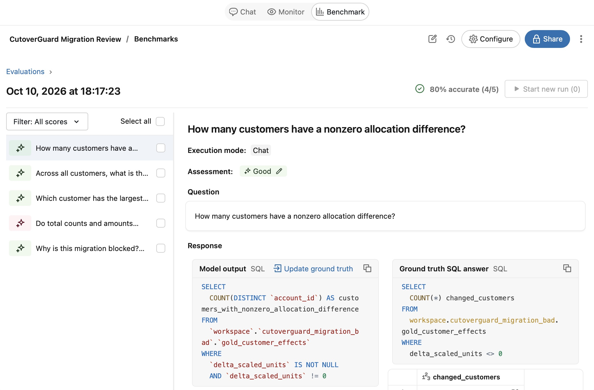
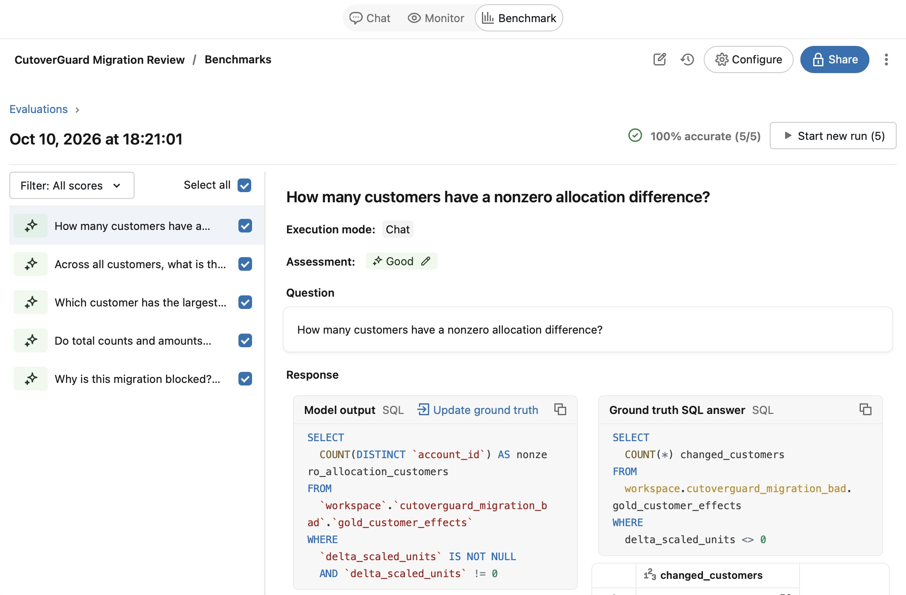

# Genie on pipeline evidence

CutoverGuard Migration Review uses four persisted gold tables from the defective TPC-H customer-crosswalk experiment: `gold_cutover_decision`, `gold_aggregate_checks`, `gold_order_issues`, and `gold_customer_effects` in `workspace.cutoverguard_migration_bad`.

Genie explains verified evidence. It is not the reconciliation engine or the promotion authority. SELECT-only behavior is instructed; it does not change the user's database permissions. Prices are arbitrary price units, with stored amounts scaled by 100. Allocation differences are not losses or profits.

## Benchmark method

Five authored questions have independent SQL answers, executed and reviewed in the native benchmark preview. Chat-mode evaluation compares generated query result sets to those answers. The SQL answers were not generated by Genie. Ground truth is kept unchanged after failures.

| Question | Verified answer | First run |
|---|---|---|
| Why blocked? | blocked; 811 wrong-owner orders; 50 wrong mappings; zero quarantined rows; matching totals | Good |
| Counts and totals by side | 7,500,000 each; 1,133,439,215,246.25 price units each | **Bad: omitted /100 conversion** |
| Largest positive customer allocation difference | customer 92948; +3,096,745.42 price units | Good |
| Net signed customer allocation difference | 0.00 price units | Good |
| Customers with nonzero allocation differences | 50 | Good |

First native run: **4/5 (80%)**, October 10, 2026, 18:17:23 EDT. Run ID `01f1c4f85e651e839d693a3fd184c385`.

Second native run: **5/5 (100%)**, October 10, 2026, 18:21:01 EDT. Run ID `01f1c4f8dfc714adb5d2a36486a5b55d`.

After this failure, a curated example query was added for side-specific totals with `CAST(total_scaled_units / 100 AS DECIMAL(38,2))`. The second run is a regression test after tuning, not an independent held-out accuracy estimate. Five questions on one frozen synthetic dataset cannot establish general reliability. Native SQL grading also does not establish explanation quality, permission safety, latency performance, or production readiness. Demo wording must be manually reviewed.

See Databricks' [benchmark documentation](https://docs.databricks.com/aws/en/genie-agents/monitor) for Chat-mode result comparison versus Agent-mode LLM grading.

Question text, SQL ground truth and both run assessments are saved in [benchmark questions](../evidence/genie-benchmark-questions.json). The [result summary](../evidence/genie-benchmark-summary.json) preserves the failed conversion.

## Manual demo checks

The live conversation correctly reported 811 wrong-owner orders and 50 wrong mappings; 7,500,000 rows and 1,133,439,215,246.25 price units on both sides; and customer 92948 with +3,096,745.42 allocation difference. Cropped answer captures are in `assets/demo`. The colloquial “gained” question was answered as candidate allocation, but the safer demo wording is “largest positive allocation difference.” Neither phrasing establishes profit or realized loss.

